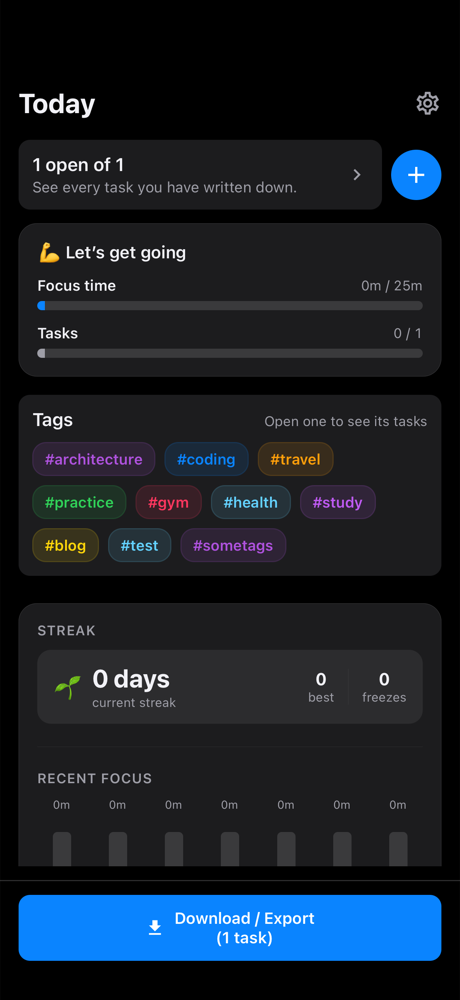
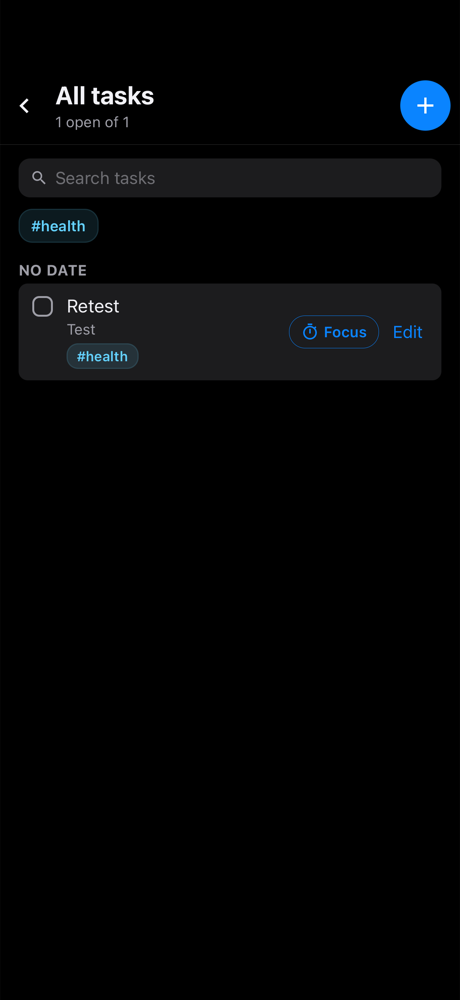
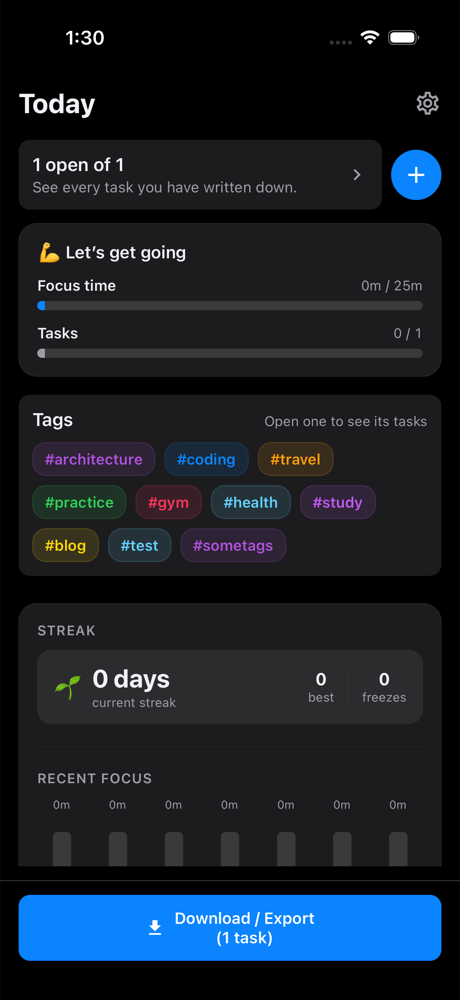

# MyApp

A **local-first React Native productivity app**: a task list with per-task focus
timers, OS notifications, and a focus-session history with streaks and momentum.
No backend, no accounts — every fact the app renders lives on the device, in
memory or under a small set of `AsyncStorage` keys (see
[`docs/INTEGRATION.md`](docs/INTEGRATION.md) for the full list).

<p align="center">
  
  
  
</p>

> **Project docs**
> - [`docs/ARCHITECTURE.md`](docs/ARCHITECTURE.md) — layers, state ownership, invariants.
> - [`docs/INTEGRATION.md`](docs/INTEGRATION.md) — native modules, storage keys, notifications, testing.

---

## Features

### Tasks
- Create, edit, complete, and delete tasks, each with optional **notes**,
  **due date**, and **due time**.
- The list is **grouped by due date** — Overdue, Today, Upcoming, No date, and
  Completed last — so it reads as organised rather than merely listed.
- **Search** across task text and **multi-tag filtering** from the list header.
- **Swipe** a row for quick actions (complete / stop a running timer), or tap to
  start focusing and edit.
- Malformed stored data is repaired field-by-field on load: a bad field costs the
  field, never the task.
- **Editable daily goals**: the home progress tile opens a dedicated **Goals &
  Preferences** screen for setting task and focus targets, with a live preview of
  today against them. Goals persist in their own key, survive restarts and the
  "Clear focus history" reset, and drive a contextual, deterministic
  encouragement line.

### Focus timers
- A **per-task focus timer** with a duration picker (opens on 25 minutes).
- Start, pause, resume, and stop. The countdown is derived from an absolute end
  time, so backgrounding the app cannot desynchronise it.
- A timer that runs to **zero completes the task** and locks it against
  reopening — derived from the session log, not a separate flag.
- Timers **survive a relaunch**: they are restored from the OS notification that
  is still pending, and a past end time is treated as an expiry.

### Notifications & reminders
- **Timer alerts** — tapping one opens the task it belongs to.
- **Daily focus prompt** (09:00 local, a 7-day rolling window).
- **Streak-at-risk** warning (20:00 local when the streak is alive and today is
  still incomplete).
- **Per-task reminders** one entry per open task with a future due date *and*
  time.
- Permission is requested on launch; if it is refused, the home screen says so.
- Every trigger is a one-shot timestamp reconciled against what the OS actually
  holds, so scheduled work can never stack duplicates or leave orphans.

### Progress on the home screen
- **Momentum** — a one-line read on how today is going.
- **Two daily goals** — focus time and tasks completed — against the targets you
  set in **Goals & Preferences**.
- **Streak** — current, best, and remaining freezes.
- **Recent focus** — a 7-day chart: tap a bar to fill it green and see that day's
  time and task count; a full bar is 12 hours of focus.

### Tags
- A built-in vocabulary plus **your own tags**, added right from the home screen.
- A new tag is entered through a caret-only field: invisible at rest, it becomes
  a **coloured chip with a cursor** the moment you focus it, tinted with the hue
  the tag will take.
- Only the label is persisted; the colour is **derived deterministically** from
  it, so every surface that draws the tag agrees without storing a second copy.
- Typed input is normalised (`#Deep Work` → `#deepwork`) and de-duplicated against
  the vocabulary.

### Look, feel & accessibility
- **Light / dark / follow-system** theme, switchable in Settings. Components hold
  **no colours** — a source-reading test fails the build on a stray hex literal.
- **Screen transitions** — a short fade and directional slide on every
  destination change, skipped when **Reduce Motion** is on.
- Haptic feedback on create and completion.
- Accessibility labels on every control, with selected/disabled state exposed.

### Local-first & export
- Everything persists to `AsyncStorage` under a small set of independent keys
  (tasks, productivity, theme preference, custom tags, and daily goals);
  clearing one never touches another.
- **Export/share** the task list as JSON from the home screen, named by the local
  day (never a UTC day).

---

## Getting Started

> **Note**: Make sure you have completed the [Set Up Your Environment](https://reactnative.dev/docs/set-up-your-environment) guide before proceeding.

### Step 1: Start Metro

Start the JavaScript build server from the project root:

```sh
# Using npm
npm start

# OR using Yarn
yarn start
```

### Step 2: Build and run the app

With Metro running, open a new terminal in the project root:

#### Android

```sh
npm run android
# OR
yarn android
```

### iOS

Install CocoaPods dependencies first (only needed on first clone or after
updating native deps):

```sh
bundle install
bundle exec pod install
```

Then run:

```sh
npm run ios
# or
yarn ios
```

If everything is set up correctly, the app opens in the iOS Simulator, Android
emulator, or your connected device. You can also build directly from Xcode or
Android Studio.

### Modify your app

Open `App.tsx` and make changes — the app hot-reloads via Fast Refresh. To force
a full reload:

- **Android**: press <kbd>R</kbd> twice, or open the Dev Menu with <kbd>Ctrl</kbd>+<kbd>M</kbd> (Windows/Linux) / <kbd>Cmd ⌘</kbd>+<kbd>M</kbd> (macOS).
- **iOS**: press <kbd>R</kbd> in the iOS Simulator.

---

## Quality gates

Run from the project root:

```sh
npx tsc --noEmit   # types
npx eslint .       # 0 errors expected
npx jest           # full suite
```

There is also a headless iOS build for CI-like runs:
`npm run ios:headless` (boots a simulator without opening Simulator.app).

---

## Architecture at a glance

Thin containers, dumb UI, and pure domain logic — see
[`docs/ARCHITECTURE.md`](docs/ARCHITECTURE.md) for the full model.

```
App.tsx              providers + Screen navigation (home | tasks | tag | goals | settings)
WelcomeComponent     composition point for the five screens
components/*         presentational screens and rows
hooks/*              controllers (useTaskScreen, useSettings, useTimerOrchestration, …)
todos/ productivity/ notifications/ domain + adapters (pure where it can be)
```

- **No router and no state library** — five screens and one flat reducer are
  enough; navigation is a single `Screen` union.
- **One source of truth per fact** — the OS owns scheduled work, derived values
  are computed on read, and persistence sits behind a repository boundary.
- **Local-calendar time** — day keys are `YYYY-MM-DD` strings and `toISOString()`
  is deliberately absent, so a UTC conversion can never shift a calendar day.

---

## Troubleshooting

If the steps above don't work, see the
[React Native Troubleshooting](https://reactnative.dev/docs/troubleshooting) page.

## Learn more

- [React Native](https://reactnative.dev) — the framework.
- [React Native docs](https://reactnative.dev/docs/getting-started) — the basics.
- [`@facebook/react-native`](https://github.com/facebook/react-native) — the
  open-source repository.
